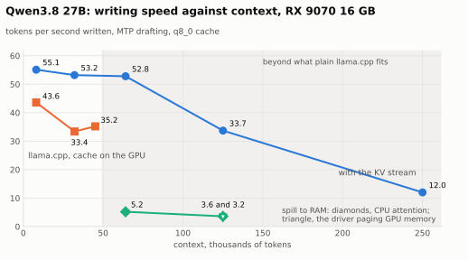
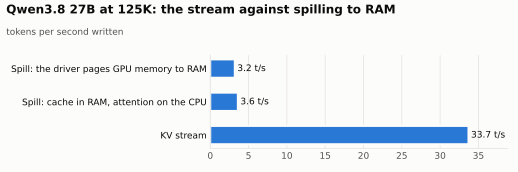
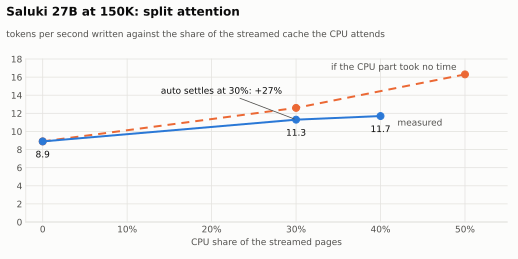
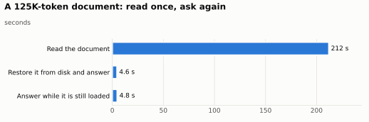

# llama.cpp-kvstream

Long context on a 16 GB consumer GPU: a llama.cpp fork that runs a 27B model at up to 250K tokens of context on an
AMD Radeon RX 9070, where plain llama.cpp stops at 48K. The KV cache lives in host RAM and the pages each step needs
stream to the card; at depth the CPU attends over part of the cache in parallel with the GPU.

> Scope. This is a fork of llama.cpp (through achyudh's KV-streaming branch) with measurements on one machine: an RX
> 9070 (the non-XT card, 16 GB), a Ryzen 9 5900X, dual-channel DDR4 and PCIe 4.0. It is not a new inference engine
> and not a serving gateway. Every number below has a log in `kvstream/results/` and a script in `kvstream/bench/`.
> Where something does not help, it says so.

## What you get

<picture>
  <source media="(prefers-color-scheme: dark)" srcset="kvstream/docs/figures/context-dark.svg">
  
</picture>

[Qwen3.8 27B](https://huggingface.co/unsloth/Qwen3.8-27B-GGUF) (3-bit), 8-bit cache, MTP drafting, writing speed in
tokens per second:

| context | plain llama.cpp | spill: cache in RAM, CPU attention | spill: driver pages to RAM | KV stream |
|---|---|---|---|---|
| 8K | 43.6 | | | 55.1 |
| 32K | 33.4 | | | 53.2 |
| 45K | 35.2 | | | |
| 64K | does not fit | 5.2 | | 52.8 |
| 125K | does not fit | 3.6 | 3.2 | 33.7 |
| 250K | does not fit | | | 12.0 |

Reading a 125K-token prompt takes 4.6 minutes with the stream (456 t/s), 6.6 minutes spilled with CPU attention
(316 t/s) and 21 minutes with the driver paging (101 t/s); 250K takes 12.6 minutes with the stream (330 t/s).

- Plain is an everyday llama.cpp build (Vulkan); the stream is this fork (HIP). Below 48K nothing streams yet, so the
  stream's higher writing speed there comes from the fork's build and kernels, not from streaming; the Vulkan build
  reads faster at short depth (812 against 705 t/s at 8K).
- Spilling is what llama.cpp offers when the cache does not fit: `--no-kv-offload` (cache in RAM, attention on the
  CPU), or letting the GPU driver page memory to RAM (`GGML_CUDA_ENABLE_UNIFIED_MEMORY=1`). At 125K the stream writes
  about 9 to 10 times faster than either.
- That gain is the KV stream's design: [achyudh's RDNA4 fork](https://github.com/achyudh/llama.cpp) on
  [RaymondHuang210129's adaptive KV streaming](https://github.com/RaymondHuang210129/llama.cpp-adaptive-kv-streaming).
  What this repository adds on top is listed below; the comparison with both ways of spilling is measured here.

<picture>
  <source media="(prefers-color-scheme: dark)" srcset="kvstream/docs/figures/vs-ram-dark.svg">
  
</picture>

For reading large documents, [Saluki 27B](https://huggingface.co/ConwayResearch/Underdog-Saluki-27B-1.0) (a 2-bit
Qwen3.8 with vision) leaves room for more cache on the GPU: 30.2 t/s at 125K and 25.9 at 175K with 5400 MiB of cache
on the GPU; at 250K 3.9 t/s, and 5.3 with split attention (below).

## Models

| name here | file | from | built on |
|---|---|---|---|
| Qwen3.8 27B | `Qwen3.8-27B-UD-IQ3_S.gguf`, 12.0 GB, 3-bit, with the MTP head used for drafting | [unsloth/Qwen3.8-27B-GGUF](https://huggingface.co/unsloth/Qwen3.8-27B-GGUF) | [Qwen/Qwen3.8-27B](https://huggingface.co/Qwen/Qwen3.8-27B) |
| Saluki 27B | `Underdog-Saluki-27B-1.0-IQ2-mix.gguf`, 7.9 GB, 2-bit, and `mmproj-Underdog-Saluki-27B-1.0-Q8_0.gguf` for vision | [ConwayResearch/Underdog-Saluki-27B-1.0](https://huggingface.co/ConwayResearch/Underdog-Saluki-27B-1.0) | [ISTA-DASLab/Qwen3.8-27B-GSQ-RCO-GGUF](https://huggingface.co/ISTA-DASLab/Qwen3.8-27B-GSQ-RCO-GGUF), from Qwen3.8 27B |

Both have the attention shape the streaming kernels take (16 attention layers with 4 KV heads of 256, 6 query heads
per KV head), so both stream. The files measured are these downloads: the Qwen3.8 file has the published SHA-256,
the Saluki model file the published size and its vision projector the published SHA-256.

## What each piece adds

| piece | from | effect, measured on the machine above |
|---|---|---|
| KV streaming | achyudh's fork | context 48K -> 250K on 16 GB; at 125K about 9 to 10x faster writing than spilling the cache to RAM |
| 8-bit V cache in the streaming kernel | this repository | long context usable for coding (the 4-bit V cache made the model loop); 8 to 35% slower than 4-bit (runs at different power caps) |
| a larger GPU share of the cache for small models | this repository | Saluki at 125K: 16.2 -> 30.2 t/s (+86%) |
| split attention (CPU and GPU at once) | this repository | Saluki at 150K: 8.9 -> 11.3 t/s (+27%); off where it does not pay |
| CPU attention kernel | this repository | 2 to 2.3x faster on the CPU (the part the split runs) |
| save the read document to disk | llama.cpp's slot save, measured here | asking about a 125K document again: 3.5 min -> about 5 s |

## Split attention

At depth most of the cache crosses PCIe for every written token, and the link is the limit. The CPU sits next to that
memory. With `LLAMA_KV_SPLIT=auto` the CPU attends over the oldest pages in place in RAM while the GPU attends over
the rest, and the GPU merges the two parts exactly through their log-sum-exp; less crosses the link.

<picture>
  <source media="(prefers-color-scheme: dark)" srcset="kvstream/docs/figures/split-dark.svg">
  
</picture>

- Exact up to rounding: the parts merge by their log-sum-exp, which is exact arithmetic. Short greedy answers
  (about 160 tokens) were identical with and without the split; over longer answers the wording can drift at near-ties,
  as with any change of kernel. On the second machine every layer's output was checked against exact attention: as
  close with the split as without.
- No regressions: nothing splits while the whole cache fits on the GPU (at 30K: 33.8 t/s with auto, 33.7 to 33.9
  without), and auto starts at no split and keeps a larger CPU share only while each token gets faster.
- Where it does not pay: with speculative decoding (verifying 4 to 5 drafted tokens at once) the CPU part is bound by
  arithmetic, and auto stays at no split (Qwen3.8 at 125K: 33.6 t/s against 32.6 to 34.0 without).
- The limit on this machine is memory: with the split, the PCIe stream and the CPU together read about 42 GB/s from
  dual-channel DDR4-3200, whose peak is about 51 GB/s.
- Off unless `LLAMA_KV_SPLIT` is set (`auto`, or a fixed share); `LLAMA_KV_SPLIT_THREADS` sets the CPU threads.
  HIP (RDNA4) only for now; elsewhere it switches itself off with a warning.

Design and every measurement: [kvstream/design/split-attention.md](kvstream/design/split-attention.md).

## Read once, ask later

<picture>
  <source media="(prefers-color-scheme: dark)" srcset="kvstream/docs/figures/reask-dark.svg">
  
</picture>

A long document read once can be saved with its cache (4.2 GB at 125K) and questioned again after a restart within
seconds (`kvstream/bench/run-save-restore.sh`).

## On a second machine: an NVIDIA laptop

The same runs on a very different machine: a ThinkPad X1 Extreme Gen 2 with a GTX 1650 Max-Q (4 GB, 35 W, Turing),
an i7-9750H (6 cores), 32 GB of DDR4-2667 and PCIe 3.0. It runs
[RaymondHuang210129's CUDA streaming fork](https://github.com/RaymondHuang210129/llama.cpp-adaptive-kv-streaming)
at bcf1a81d6 with six patches from this work: a build option, the CPU attention kernel, a cached host copy of the
cache, split attention, auto, and the tests (`kvstream/second-machine/`, with how to build and run). The model is
Qwen3.5 4B (Q4_K_M), since a 27B model does not fit 4 GB; q8_0 cache, no drafting (no MTP head). Logs:
`kvstream/results/gtx1650-i7-9750h/`.

| writing t/s | 8K | 32K | 42K | 64K | 125K |
|---|---|---|---|---|---|
| plain (the most that fits: 43K) | 25.7 | 19.2 | 17.4 | does not fit | does not fit |
| spill: cache in RAM, CPU attention | | 8.5 | | 5.4 | |
| spill: driver pages to RAM | | | | 3.1 | |
| KV stream | 25.5 | 19.0 | | 13.9 | 7.0 |
| KV stream with split attention (auto) | | | | 13.8 (stays off) | 8.3 |

- The stream reaches 2.9 times plain's context; where both run it costs at most 1.2%.
- Against spilling at 64K it writes 2.6 times faster than CPU attention and 4.5 times faster than driver paging
  (beast: about 10 times). Reading speed is level with spilling at these depths: on this GPU reading is bound by its
  arithmetic, not by where the cache lives. Spilling at 125K was not measured (each request needs more than 30
  minutes).
- Split attention: +19% at 125K over a short answer, +25% once auto has settled (at 0.3); at 64K little streams and
  auto stays off, as it should.

## Quick start

Linux, ROCm and an RDNA4 GPU (gfx1201):

```bash
kvstream/scripts/build-rocm.sh                                   # HIP build into build-hip/
MODEL=/path/to/Qwen3.8-27B.gguf kvstream/scripts/serve-long.sh 204800 8090
LLAMA_KV_SPLIT=auto MODEL=... kvstream/scripts/serve-long.sh 163840 8090   # with split attention
python3 kvstream/bench/longctx.py 8090 125000                    # the long-context probe
```

Options, the probe, and every run script: [kvstream/README.md](kvstream/README.md).

## What it does not do

- Only models whose attention has head size 256 and 6 query heads per KV head stream (Qwen3.8 27B and models built on
  it). Other shapes need kernel variants that do not exist yet.
- This fork is tested on Linux with ROCm and an RDNA4 GPU only. On NVIDIA, the measurements above use RaymondHuang's
  CUDA fork with the patches in `kvstream/second-machine/`, on one laptop.
- An intermittent copy stall: in some deep runs a page copy never lands and the stream's watchdog stops the server
  (3 times so far, all with Saluki, while reading 160K to 250K; logs in `kvstream/results/`). Under investigation.
- Based on llama.cpp from 2026-10-21, not rebased onto current upstream.
- The fork's own numbers (100+ t/s) come from an RX 9070 XT with IQ4_XS weights and a 4-bit V cache, and its README
  recommends PCIe 5.0 and DDR5; the numbers here are from the cheaper non-XT card on PCIe 4.0 and DDR4, with an 8-bit
  V cache, and are not directly comparable.

## Where this comes from

| layer | author | what it brings |
|---|---|---|
| [ggml-org/llama.cpp](https://github.com/ggml-org/llama.cpp) | the ggml authors | everything else |
| [RaymondHuang210129/llama.cpp-adaptive-kv-streaming](https://github.com/RaymondHuang210129/llama.cpp-adaptive-kv-streaming) | RaymondHuang210129 | adaptive KV streaming, on CUDA |
| [stew675/llama-cpp-rdna-boosts](https://github.com/stew675/llama-cpp-rdna-boosts) | stew675 | RDNA kernel work |
| [achyudh/llama.cpp](https://github.com/achyudh/llama.cpp), branch `feature/adaptive-kv-stream-rocm` | achyudh | the KV stream for RDNA4 in ROCm/HIP, RDNA4 kernels, MTP and n-gram drafting; its README is kept as [README-kvstream-fork.md](README-kvstream-fork.md) |
| this repository | David Sandquist, Katalyst Nord | the 8-bit V streaming kernel, split attention, the CPU attention kernel, the measurements |

This repository starts from achyudh's branch at b540a4b9b (2026-10-22). Thanks also to raffidahmad for the Windows
build recipe and to u/bottlestreet3d on Reddit for the report of Qwen3.8 at 262K on an RX 9070 XT.

Not related: [microsoft/KVstream](https://github.com/microsoft/KVstream) is an HTTP gateway in front of Foundry Local
(admission control, port discovery); it holds no KV cache. This repository works inside the engine.

## Repository

| | |
|---|---|
| `kvstream/README.md` | all tables, how to run, the probe |
| `kvstream/design/` | split attention, the tiered KV scheduler |
| `kvstream/results/rx9070-ryzen5900x/` | the raw logs behind every number |
| `kvstream/docs/figures/` | the figures and `data.json`, which names the log of each number (`kvstream/scripts/make-figures.py` redraws them) |
| branch `main` | everything above |
| branch `split-attention` | the split attention work, commit by commit; tags `split-attention-v1`, `split-attention-v2` |
| branch `cpu-fa-block` | the first blocked CPU kernel (since ported onto `main`) |

## License

MIT, as llama.cpp ([LICENSE](LICENSE)).
